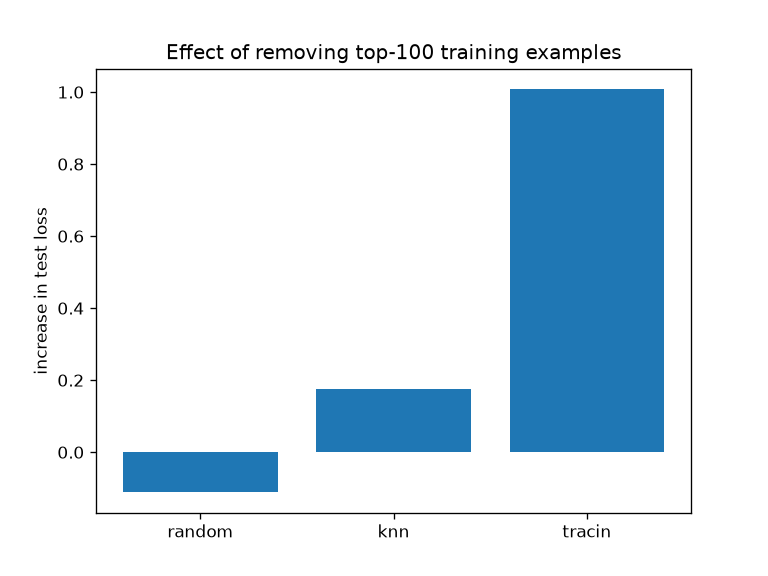

# TraceML: Training Data Attribution and Model Behavior Forensics

**Research question:** Which training examples are responsible for a model's
particular predictions, mistakes, or undesirable behavior?

TraceML implements training data attribution (TracIn and a nearest-neighbor
baseline) on a small CIFAR-10 CNN, and tests it against retraining ground truth
and a label-noise forensics task.

## Setup

- Model: small CNN (no BatchNorm), plain SGD, trained on a 5,000-image CIFAR-10
  subset with a learning-rate schedule. Final test accuracy is about 56%.
- Checkpoints and per-epoch learning rates are saved for TracIn.
- Everything runs on CPU.

```
common.py        shared model and data code
models/train.py  trains the model and saves checkpoints
attribution/     knn.py (baseline), tracin.py
eval/            retrain.py (ground truth), label_noise.py, label_noise_val.py
```

## Reproduce

```
pip install -r requirements.txt
python models/train.py
python -m attribution.knn
python -m attribution.tracin
python -m eval.retrain
python -m eval.label_noise
python -m eval.label_noise_val
```

## Results

### 1. Do attribution scores point to examples of the right class?

Fraction of the top-10 training examples that share the test image's true class
(100 test images):

| Method | Same-class fraction |
|---|---|
| Random | 0.09 |
| kNN (embedding similarity) | 0.50 |
| TracIn, most helpful | 0.99 |
| TracIn, most harmful | 0.00 |

This is a sanity check, not causal evidence. TracIn also uses the test label,
which kNN does not, so the comparison is not fully fair.

### 2. Ground truth: does removing the top examples change the prediction?

For each of 5 test images, the top-100 training examples chosen by each method
were removed, the model was retrained from scratch (3 seeds), and the increase
in that image's test loss was measured.

| Method | Mean increase in test loss |
|---|---|
| Random removal | -0.112 |
| kNN | +0.175 |
| TracIn | +1.008 |



TracIn had the highest mean on all 5 images, but retraining noise is large
(per-image standard deviations up to about 1.1), so exact values should not be
over-interpreted.

### 3. Forensics: finding corrupted labels (30% label noise)

1,500 of 5,000 training labels were flipped to a random other class.

| Detector | AUROC | Precision@1500 |
|---|---|---|
| Random | 0.501 | 0.307 |
| TracIn validation-influence | 0.584 | 0.405 |
| TracIn self-influence | 0.696 | 0.479 |
| Loss + validation-influence | 0.773 | 0.569 |
| **Training loss** | **0.847** | **0.663** |

Repair test: remove the flagged examples, retrain, and measure test accuracy on
the full 10,000-image test set (3 seeds).

| Setting | Test accuracy |
|---|---|
| Clean labels (ceiling) | 0.489 |
| Oracle (remove exactly the corrupted) | 0.480 |
| Training-loss cleaning | 0.460 |
| No cleaning | 0.445 |
| Loss + validation-influence | 0.437 |
| Self-influence cleaning | 0.430 |
| Random removal | 0.426 |
| Validation-influence cleaning | 0.390 |

## Findings

- TracIn finds training examples that causally affect individual predictions,
  clearly more than random or nearest-neighbor selection in this setup.
- For cleaning label noise, plain training loss beat every attribution-based
  detector I tried, and it was the only practical method that improved accuracy.
- Cleaning with validation-influence made accuracy worse than no cleaning. I
  have not yet verified why.

## Limitations

- Small model, small dataset (5,000 images), one dataset.
- Ground-truth test uses only 5 test images and 3 seeds.
- One label-corruption draw and one noise rate for the forensics experiment.
- The kNN baseline ignores the label, which makes the comparison with TracIn
  unfair to it.

## Roadmap

- [x] CIFAR-10 CNN with checkpoints
- [x] kNN baseline
- [x] TracIn attribution
- [x] Retraining ground-truth test
- [x] Label-noise detection and repair
- [ ] Label-aware kNN baseline
- [ ] Removal-size sweep and more test images
- [ ] Class-conditional validation-influence
- [ ] Backdoor/poison detection
- [ ] Dashboard