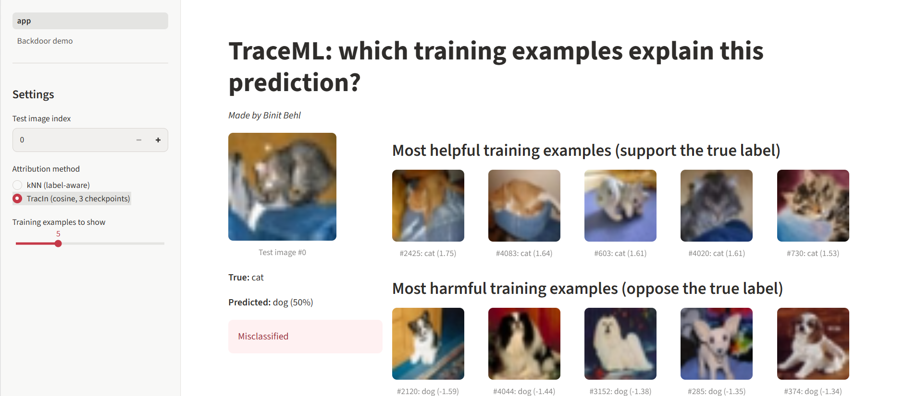
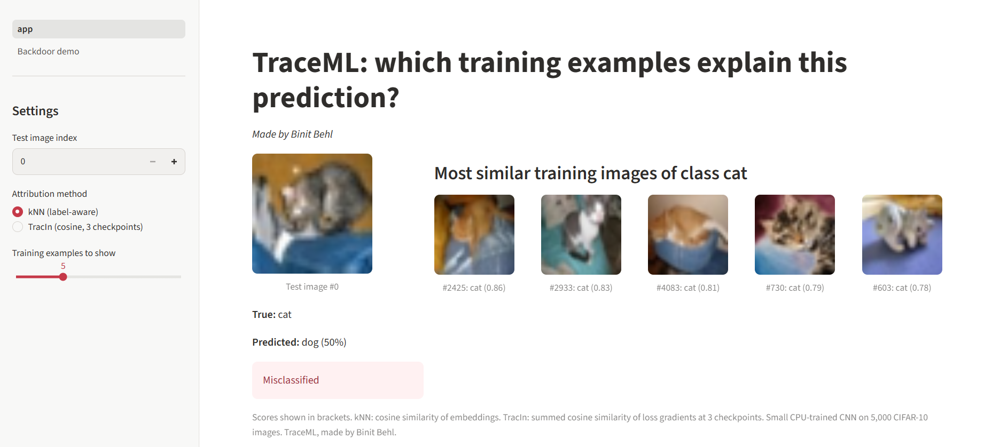
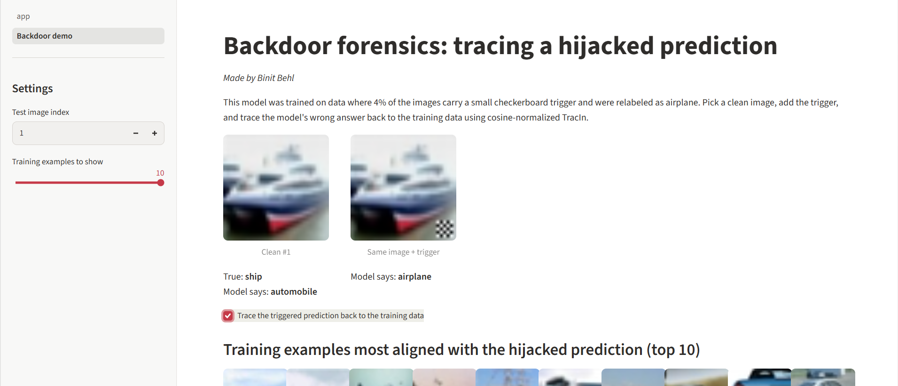
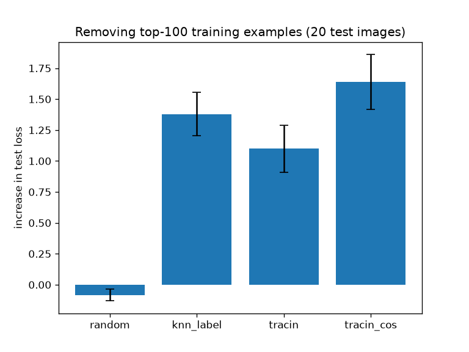

# TraceML: Training Data Attribution and Model Behavior Forensics

Made by Binit Behl

**Research question:** Which training examples are responsible for a model's
particular predictions, mistakes, or undesirable behavior?

TraceML implements training data attribution (TracIn and a nearest-neighbor
baseline) on a small CIFAR-10 CNN. It tests the attribution scores against
retraining ground truth and on two forensics tasks: finding corrupted labels and
finding a backdoor. A Streamlit dashboard lets you explore the results.

## Dashboard

Pick any test image and see the training examples that most support or oppose the
model's prediction. TracIn mode (below) shows the most helpful and most harmful
training examples:



Nearest-neighbor mode shows the training images most similar to the test image
from its true class:



The backdoor page adds a trigger to a clean image, shows the model being hijacked,
and traces the wrong answer back to the poisoned training images:



```
pip install -r requirements.txt
streamlit run app/app.py
```

Run it from the project root, after training the model (see Reproduce).

## Setup

- Model: small CNN (no BatchNorm), plain SGD, trained on a 5,000-image CIFAR-10
  subset with a learning-rate schedule. Final test accuracy is about 56%.
- Checkpoints and per-epoch learning rates are saved, because TracIn needs them.
- Everything runs on CPU.

```
common.py          shared model and data code
models/train.py   trains the model and saves checkpoints
attribution/      knn.py (baseline), tracin.py
eval/             retrain.py, analyze.py, retrain_extra.py,
                  retrain_large.py                      ground-truth tests
                  label_noise.py, label_noise_val.py,
                  label_noise_cos.py                    label-noise forensics
                  backdoor.py, backdoor_fix.py,
                  backdoor_repair.py, grad_norms.py     backdoor forensics
app/              app.py and pages/1_Backdoor_demo.py   dashboard
docs/             screenshots and charts used in this README
```

## Reproduce

Run in this order, since later scripts reuse earlier outputs (checkpoints and
saved results). Generated files go to `ckpts/`, `data/` and `results/`, which are
git-ignored.

```
pip install -r requirements.txt
python models/train.py
python -m attribution.knn
python -m attribution.tracin
python -m eval.retrain
python -m eval.analyze
python -m eval.retrain_extra
python -m eval.retrain_large
python -m eval.label_noise
python -m eval.label_noise_val
python -m eval.label_noise_cos
python -m eval.backdoor
python -m eval.backdoor_fix
python -m eval.backdoor_repair
python -m eval.grad_norms
streamlit run app/app.py
```

Several scripts retrain the model dozens of times; on a laptop CPU
`retrain_large` takes about 3 hours.

## Methods

- **kNN baseline:** rank training images by cosine similarity between the
  penultimate-layer embeddings of the test and training images. The
  *label-aware* version only considers training images of the test image's true
  class, which makes the comparison with TracIn fair.
- **TracIn:** for a test example, sum over saved checkpoints
  `learning_rate * <gradient of the test loss, gradient of the training loss>`
  for every training example. Positive scores mean helpful, negative mean
  harmful.
- **Cosine TracIn:** the same, but both gradients are normalized to unit length
  first, so only their direction matters.
- **Self-influence:** a training example's own TracIn score (squared gradient
  norm summed over checkpoints), used to find unusual examples.
- **Validation-influence:** score each training example against the gradients of
  a small set of trusted, clean validation images.

## Results

### 1. Do attribution scores point to examples of the right class?

Fraction of the top-10 training examples that share the test image's true class
(100 test images):

| Method | Same-class fraction |
|---|---|
| Random | 0.09 |
| kNN (embedding similarity, ignores the label) | 0.50 |
| TracIn, most helpful | 0.99 |
| TracIn, most harmful | 0.00 |

This is a sanity check, not causal evidence. TracIn also uses the test label,
which this kNN does not, so the comparison is not fully fair to kNN.

### 2. Ground truth: does removing the top examples change the prediction?

For each of the first 20 test images, the top-100 training examples chosen by
each method were removed, the model was retrained from scratch (2 seeds), and the
increase in that image's test loss was measured. Higher means the removed
examples mattered more.

| Method | Mean increase in test loss (± standard error across images) |
|---|---|
| Random removal | -0.08 ± 0.05 |
| TracIn, raw | +1.10 ± 0.19 |
| kNN, label-aware | +1.38 ± 0.17 |
| **TracIn, cosine** | **+1.64 ± 0.22** |

Paired differences, which cancel the large differences between images:

| Comparison (A minus B) | Mean difference | Images where A is higher |
|---|---|---|
| Cosine TracIn minus label-aware kNN | +0.26 ± 0.11 | 14 / 20 |
| Cosine TracIn minus raw TracIn | +0.54 ± 0.15 | 16 / 20 |
| Raw TracIn minus label-aware kNN | -0.28 ± 0.14 | 7 / 20 |
| Label-aware kNN minus random | +1.46 ± 0.20 | 20 / 20 |
| Cosine TracIn minus random | +1.72 ± 0.25 | 20 / 20 |



An early version of this test used a kNN baseline that ignored the test label
(+0.17 on the first 5 images). That comparison was unfair to kNN: restricting kNN
to the true class raised its effect to about +1.4. Only the label-aware numbers
are reported above.

### 3. Forensics: finding corrupted labels (30% label noise)

1,500 of 5,000 training labels were flipped to a random other class. The model
trained on the noisy labels reaches 0.447 test accuracy. Scores are used to flag
the 1,500 most suspicious examples.

| Detector | AUROC | Precision@1500 |
|---|---|---|
| Random | 0.501 | 0.307 |
| TracIn raw, class-conditional validation-influence | 0.469 | 0.283 |
| TracIn validation-influence | 0.584 | 0.405 |
| TracIn cosine, all validation images | 0.663 | 0.463 |
| TracIn self-influence | 0.696 | 0.479 |
| TracIn cosine, class-conditional validation-influence | 0.744 | 0.561 |
| Loss + validation-influence | 0.773 | 0.569 |
| Loss + cosine class-conditional | 0.830 | 0.651 |
| **Training loss** | **0.847** | **0.663** |

The plain validation-influence row used 500 validation images; the
class-conditional and all-validation variants used 1,000. Compare the variants
with each other rather than with the older row.

Repair test: remove the flagged examples, retrain, and measure test accuracy on
the full 10,000-image test set (3 seeds).

| Setting | Test accuracy (sd) |
|---|---|
| Clean labels (ceiling) | 0.489 (0.016) |
| Oracle (remove exactly the corrupted) | 0.480 (0.002) |
| Training-loss cleaning | 0.460 (0.004) |
| Loss + cosine class-conditional | 0.454 (0.003) |
| No cleaning | 0.445 (0.005) |
| Loss + validation-influence | 0.437 (0.005) |
| Self-influence cleaning | 0.430 (0.002) |
| Cosine class-conditional cleaning | 0.426 (0.002) |
| Random removal | 0.426 (0.002) |
| Validation-influence cleaning | 0.390 (0.008) |

### 4. Forensics: finding a backdoor

200 of 5,000 training images (4%) were stamped with a 5x5 checkerboard trigger
and relabeled "airplane". The model keeps its clean accuracy (0.507) but sends
100% of triggered non-airplane test images to "airplane". Attribution was run on
20 triggered test images that the model sends to "airplane".

Fraction of each image's top-50 training examples that are poisoned (base rate
0.04), and detection of all 200 poisoned images from the summed scores:

| Method | Top-50 poisoned | Detection AUROC |
|---|---|---|
| Random | 0.046 | 0.530 |
| TracIn, raw dot product | 0.105 | 0.643 |
| TracIn, raw, true label | 0.070 | 0.730 |
| TracIn, raw, epoch-3 checkpoint only | 0.083 | 0.712 |
| kNN (embedding similarity) | 0.971 | 1.000 |
| **TracIn, cosine-normalized** | **0.992** | **1.000** |

As a control, raw TracIn applied to the same images without the trigger finds no
poisoned examples (top-50 fraction 0.000).

Repair: remove the 200 flagged examples, retrain (2 seeds), and re-measure.

| Setting | Clean accuracy | Attack success rate |
|---|---|---|
| No cleaning | 0.495 | 1.000 |
| Random removal | 0.511 | 1.000 |
| TracIn, raw | 0.509 | 0.993 |
| kNN | 0.516 | 0.070 |
| **TracIn, cosine** | **0.520** | **0.057** |
| Oracle (remove exactly the poisoned) | 0.520 | 0.057 |

Cosine TracIn flagged exactly the poisoned set, so its result equals the oracle.
Clean-accuracy differences of 1-2 points are within noise with 2 seeds; the drop
in attack success rate is the real effect.

#### Why raw TracIn fails here: gradient norms

Gradient norm of poisoned vs clean training examples (`eval/grad_norms.py`):

| Checkpoint | Median norm, poisoned | Median norm, clean | AUROC (low norm = poisoned) |
|---|---|---|---|
| 3 | 1.715 | 13.452 | 0.966 |
| 6 | 0.162 | 15.228 | 0.983 |
| 9 | 0.409 | 18.585 | 0.919 |
| 11 | 0.031 | 17.440 | 0.991 |

Poisoned examples are fit almost perfectly, so their gradients are tiny, and a raw
dot product ranks them low even when their direction matches the test image.

Average Spearman correlation of a score with the training example's mean gradient
norm, over the 20 triggered test images: raw TracIn +0.132, cosine TracIn -0.019.
Top-50 examples per image: raw has 1.9x the median gradient norm (0.105
poisoned), cosine has 0.1x the median norm (0.992 poisoned).

## Findings

- Methods that use the test image's label (label-aware kNN and TracIn) remove far
  more of a prediction's support than random removal. Cosine TracIn had the
  highest mean effect, and was above raw TracIn on 16 of 20 images.
- Against a fair, label-aware kNN baseline, cosine TracIn looks slightly better
  (+0.26 ± 0.11, higher on 14 of 20 images), but this is suggestive rather than
  conclusive with 20 images and 2 seeds. Raw TracIn was not better than
  label-aware kNN.
- Normalizing gradients (cosine similarity) helped TracIn in all three
  experiments: the ground-truth test, backdoor detection (raw 0.105 vs cosine
  0.992 of the top-50 poisoned), and label-noise detection (raw class-conditional
  AUROC 0.469 vs cosine 0.744).
- A gradient-norm analysis of the backdoor setup is consistent with an
  explanation for the raw failure: poisoned training examples have far smaller
  gradients than clean ones (median norm 0.031 vs 17.4 at the final checkpoint,
  1.7 vs 13.5 at the first), so a raw dot product buries them. The overall
  correlation between the raw score and gradient norm was only +0.13, so
  gradient size is not the whole story, and this is correlational evidence from
  one backdoor setup.
- On backdoor detection, cosine TracIn fully repaired the model but only matched
  a simple kNN baseline.
- For label noise, plain training loss beat every TracIn-based detector, and it
  was the only practical method that improved accuracy.
- Better detection did not guarantee better repair. Cosine class-conditional
  cleaning detected corrupted labels well above chance but gave no better
  accuracy than random removal, probably because about 44% of what it flagged was
  clean data. I have not tested this.

## Limitations

- Small model, small dataset (5,000 images), one dataset.
- The ground-truth test uses 20 test images and 2 seeds; retraining noise is
  large (single-image results vary by a lot between seeds), so differences
  between the best methods are within a few standard errors.
- One label-corruption draw and one noise rate; one trigger pattern and one target
  class for the backdoor, which is an easy case.
- The backdoor analysis assumes some triggered, misclassified test images are
  already known.
- The gradient-norm analysis is correlational and covers only the backdoor
  setting. Cosine's top-50 had gradient norms 0.1x the median, so normalization
  favors small-gradient examples, which suits a backdoor but may not suit other
  tasks.
- The first sanity check (section 1) compares a label-free kNN with a TracIn that
  uses the label, which is unfair to kNN. Section 2 corrects this.
- Standard deviations in the repair tables reflect training-seed variation only,
  not the choice of corrupted examples.
- The dashboard uses 3 checkpoints for TracIn (the experiments use 4 to 6), so its
  rankings can differ slightly from the evaluation numbers.

## Future work

- Larger models and datasets, and a language-model version.
- A removal-size sweep and more seeds for the ground-truth test.
- Measuring gradient norms of corrupted vs clean examples in the label-noise
  setting, and testing why cleaning with better detection did not help there (for
  example, the class balance of the flagged examples).